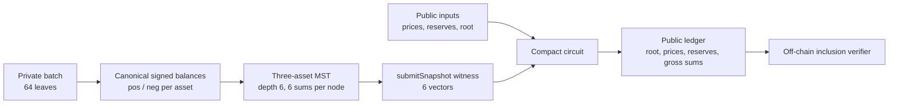

# Standardized Midnight PoR

Privacy-preserving proof-of-reserves MVP on **Midnight**: a fixed batch of 64
users is committed as a **three-asset Merkle Sum Tree** (BTC / ETH / USDT), and
a **Compact** circuit proves that every user has a positive net asset value at
public prices, that the recomputed MST root matches the published snapshot, and
that each asset's net exposure stays within the operator's declared reserves.

Built for the **Midnight Buildathon (Wave 3)** on AKINDO. Licensed under
**Apache-2.0**.

## Why this exists

A reserve report is only useful if users can check two things without exposing
their balances:

1. their liability is included in the published commitment;
2. the published commitment is consistent with a solvency statement.

This MVP does both with zero-knowledge proofs: individual balances and
`userIdHash` values stay private; the chain stores only the root, aggregate
sums, prices and declared reserves.

## Architecture



- **Off-chain** (`src/mst/`): builds the tree, computes the root and gross/net
  sums, emits inclusion paths and verifies them.
- **On-chain** (`contract/standard_por.compact`): reads the private batch from
  witnesses, recomputes the root, checks per-user NAV and per-asset exposure,
  and publishes the snapshot.
- **Midnight integration**: Compact contract, local/hosted proof server, ledger
  state, testkit wallet, and an **undeployed** local chain for the end-to-end
  demo.

## Assets and units

| Asset | Smallest unit | Decimals | Demo price (micro-USDT / unit) |
| --- | --- | --- | --- |
| BTC | satoshi | 8 | 600 (= 60,000 USDT / BTC) |
| ETH | 1e-8 ETH | 8 | 30 (= 3,000 USDT / ETH) |
| USDT | 1e-6 USDT | 6 | 1 |

A user's per-asset balance may be negative. Each signed balance `x` is encoded
canonically as `(pos, neg)` with `x = pos - neg` and `pos == 0 || neg == 0`.
MST nodes keep `Uint<128>` gross long/short sums, so 64 `Uint<64>` leaves cannot
overflow.

Prices are **public circuit inputs** (micro-USDT per smallest unit), bounded to
`0 < price <= 1e12`, and written to the ledger with the snapshot.

## Circuit and contract

`submitSnapshot(seq, ts, priceBtc, priceEth, priceUsdt, reservesBtc, reservesEth, reservesUsdt, rootHash)`
enforces:

1. the caller is the deploy-time authority — `ownPublicKey().bytes == authorityPk`;
2. signed balances are canonical for every leaf;
3. every active leaf has `NAV = Σ(pos_i * price_i) - Σ(neg_i * price_i) > 0`
   (all-zero padding leaves are exempt);
4. the MST root recomputed from the private batch equals the published root;
5. per asset, `posSum <= negSum + declaredReserves` (net exposure ≤ reserves);
6. the snapshot is published only once.

The public ledger contains `authorityPk`, `snapshotSeq`, `timestamp`, `mstRoot`,
the three prices, the three declared reserves, six gross sums, and `published`.
No individual balance or `userIdHash` is disclosed.

See [docs/MST-ENCODING.md](docs/MST-ENCODING.md) for the exact encoding and
[docs/TRUST-BOUNDARY.md](docs/TRUST-BOUNDARY.md) for what is not proved.

## Quick start

### Prerequisites

- Node.js `>=22 <23` or `>=24` (tested with Node 26.13.1)
- npm
- Compact toolchain **0.31.1** (for compiling circuits and proving keys)
- Docker Desktop with **16 GB memory** for the full `undeployed` demo
  (the k=20 prover OOMs under 8 GB)

### Install and test

```bash
npm install
npm run generate:mst-fixtures   # deterministic demo batch + vectors
npm run build-mst               # print root, net liabilities, gross sums
npm test                        # 37 tests
```

### Local demo (no Docker, no DUST)

```bash
npm run submit-snapshot         # circuit sim + proof-server health
npm run verify-inclusion        # verify the sample inclusion JSON
npm run read:por                # print simulated public ledger fields
```

### Compile the contract

```bash
compact update 0.31.1
npm run compile:standard-por
```

This generates the ZKIR, verifier and a ~291 MB `submitSnapshot.prover` under
`contract/managed/standard_por/` (the prover is gitignored because GitHub rejects
files over 100 MB).

### Deploy to a local Midnight chain

```bash
PROOF_SERVER_VERSION=8.1.3 \
INDEXER_VERSION=4.0.1 \
MIDNIGHT_NODE_VERSION=0.22.5 \
npm run undeployed:deploy-submit
```

The testkit stack (see [compose.yml](compose.yml)) starts node, indexer and proof
server, deploys `standard_por`, and submits one snapshot. Results are written to
`fixtures/undeployed-last-run.json` (gitignored) and printed as JSON.

## Reference run (undeployed)

Verified on the testkit local chain. The chain is ephemeral and is shut down
after the script, so these values are the recorded run output rather than a
permanent explorer link.

| Field | Value |
| --- | --- |
| Contract | `301f868d9e836d46e81f6024c82136ace360b504976522eb0b945550b877d117` |
| `submitSnapshot` tx | `5a5b879b942fdcdf08730a135d3793380188c180e2279bb4f42ff43c7e430344` |
| Block height | 32 |
| Authority `authorityPk` | `5aee546a493df3ac6ee85ef3ae8d647c9b9f3a640c114883113527d67ca2ec69` |
| Prices (micro-USDT) | BTC 600 / ETH 30 / USDT 1 |
| Declared reserves | BTC 137,000,000 / ETH 547,500,000 / USDT 268,000,000,000 |
| Net liabilities | BTC 117,000,000 / ETH 497,500,000 / USDT 248,000,000,000 |
| Gross sums | BTC +148,000,000 / −31,000,000; ETH +505,000,000 / −7,500,000; USDT +251,000,000,000 / −3,000,000,000 |
| MST root | `115b66282ea7e65b206336935bdfbc1ad5f72de1a186a126897defffdabd34a2` |

Circuit size: **k=20, 886,226 rows**; proving took about 2 minutes with a local
proof server.

## CLI reference

| Command | Description |
| --- | --- |
| `npm test` | MST, `standard_por` sim, inclusion, archived Wave 3 regression (37 tests) |
| `npm run compile:mst` | Compile the MST pure circuits |
| `npm run compile:standard-por` | Compile `submitSnapshot` and generate keys |
| `npm run generate:mst-fixtures` | Regenerate `fixtures/mst-batch.json` and `fixtures/snapshot-vectors.json` |
| `npm run build-mst` | Print root, net liabilities and gross sums |
| `npm run submit-snapshot` | Local circuit simulation + proof-server health |
| `npm run verify-inclusion` | Verify an inclusion JSON against the published root |
| `npm run read:por` | Read simulated public ledger fields |
| `npm run undeployed:deploy-submit` | Deploy + submit on the local testkit chain |
| `npm run proof:health` | Probe the configured proof server |

## Repository layout

```text
contract/
  standard_por.compact        # deployed contract
  mst_hash.compact            # leaf/parent hashing + NAV check
  mst_root_unrolled.compact   # generated 63-combine root + 256 checks
  mst_bundle.compact          # pure-circuit bundle
  managed/                    # compiled JS / ZKIR / verifier (prover ignored)
src/
  mst/                        # build, path, verify, constants
  standardPor*.ts             # contract wrapper, sim, witnesses, compiled contract
  submitSnapshot.ts           # dry-run CLI
  verifyInclusion.ts          # user verification CLI
  readPor.ts                  # public-field CLI
  undeployedDeploySubmit.ts   # local chain deploy + submit
scripts/
  generate-mst-fixtures.ts
  generate-mst-unrolled.compact.ts
  build-mst.ts
fixtures/
  mst-batch.json
  snapshot-vectors.json
test/
docs/
  HACKATHON-MVP-SCOPE.md
  MST-ENCODING.md
  TRUST-BOUNDARY.md
  UNDEPLOYED.md
  ARCHIVE.md
```

## Trust boundary

**Proved**: MST root consistency, canonical signed balances, per-user NAV > 0 at
the submitted prices, per-asset net exposure ≤ reserves, and authority-gated
publication.

**Not proved**: that prices reflect the real market, that `declaredReserves`
matches real assets, that the batch covers all users, that `userIdHash` maps to
a real customer, or that the exchange's internal ledger is honest. Prices are
operator-supplied public inputs, not an oracle. See
[docs/TRUST-BOUNDARY.md](docs/TRUST-BOUNDARY.md).

## Hackathon submission

This repo is the Wave 3 submission for the Midnight Buildathon. Submission
materials:

- public GitHub repository, tagged `midnightntwrk`, Apache-2.0;
- this README (setup, architecture, Midnight integration);
- [docs/PROGRESS-WAVE3.md](docs/PROGRESS-WAVE3.md) — progress made during Wave 3;
- [docs/HACKATHON-MVP-SCOPE.md](docs/HACKATHON-MVP-SCOPE.md) — scope and acceptance;
- slide deck: [docs/slides/Standardized-Midnight-PoR-Wave3.pdf](docs/slides/Standardized-Midnight-PoR-Wave3.pdf) (editable PPTX alongside it); demo video (recorded separately);
- compiled Compact artifacts under `contract/managed/`.

## Archived Wave 3 membership demo

The earlier "signed-root + membership" demo (`por_snapshot.compact` +
`schnorr.compact`, 8 leaves) is kept in-tree for regression tests only. It is not
the submission target; see [docs/ARCHIVE.md](docs/ARCHIVE.md).

## License

Apache-2.0. Midnight-related Compact and TypeScript code in this repository is
released under Apache-2.0.
