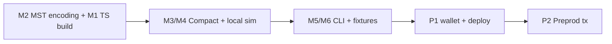

# Hackathon target: Standardized ZK-PoR MVP — minimum scope

> **Implementation update (2026-11-15)**: the implementation now covers
> **BTC / ETH / USDT**. A user's per-asset balance may be negative and is
> encoded canonically as `(pos, neg)` with `net = pos - neg`; the circuit checks
> each user's **NAV > 0** at public prices and each asset's **net exposure ≤
> `declaredReserves`**. The rest of this document still applies; the old
> single-asset `Uint<64>` balance and "negative balances unsupported" statements
> are superseded.

> **Working product name**: Standardized Midnight PoR (single-batch liability
> Merkle Sum + on-chain snapshot + user inclusion self-check)
> **Design input**: `midnight-standardized-por-assessment-and-mvp.md`
> (standardized ZK-PoR assessment and MVP architecture, team document)
> **Archived baseline**: the in-tree Wave 3 "signed root + membership" code
> (`contract/por_snapshot.compact`, `contract/schnorr.compact`; see `ARCHIVE.md`),
> **not** this submission target

---

## 1. One-sentence definition (for the hackathon stage)

On **Midnight Preprod**, an exchange builds a **Merkle Sum Tree (MST)** over a
**fixed-size single batch** of user liabilities and proves in a Compact circuit
on a local proof server that:

1. every user's **NAV is positive** at the published prices (individual asset
   balances may be negative);
2. the **MST root** recomputed inside the circuit matches the published root;
3. each asset's **net exposure ≤ the operator's declared reserves**.

After the proof passes, the public ledger stores only **snapshot metadata +
root + prices + reserves + gross sums** (no individual balances). Any user can
use an **inclusion-proof JSON** to check the published root and confirm they
were not omitted.

**Explicitly not claimed**: real-world reserves, real market prices, full user
coverage, honesty of the exchange's internal ledger, or TEE/Plonky2
equivalence.

---

## 2. Minimum scope (IN) — required for the MVP

| # | Module | Minimum specification | Acceptance |
| --- | --- | --- | --- |
| M1 | **Off-chain MST** | Fixed `LEAF_COUNT = 64` (bounded-circuit pilot; 128/1024 are extensions and do not block the hackathon) | TS library: build tree, root, net liabilities, per-user inclusion path JSON; matches circuit vectors |
| M2 | **Encoding** | Leaf commits to `(domain, userIdHash, btc, eth, usdt)` as canonical `(pos, neg)` pairs; parent sums are `Uint<128>`; written up in `docs/MST-ENCODING.md` | Unit test: vectors match circuit `pureCircuits` |
| M3 | **Compact contract** | `standard_por.compact`: `submitSnapshot(seq, ts, prices, reserves, root)` | `compact compile` 0.31.1; local/hosted proof health passes |
| M4 | **Circuit constraints** | Witness: 64 leaves with signed BTC/ETH/USDT; assertions: canonical `(pos,neg)`, per-user NAV > 0, MST root, net exposure ≤ reserves | Valid batch sim passes; negative NAV / tampered root / over-reserve batch rejected |
| M5 | **On-chain state** | Flat ledger (no Map in the MVP): `authorityPk`, `snapshotSeq`, `timestamp`, `mstRoot`, `priceBtc/Eth/Usdt`, `declaredReserves*`, `liabilities*Pos/Neg`, `published` | `npm run read:por` reads fixtures or live values |
| M6 | **CLI** | `build-mst` / `submit-snapshot` / `verify-inclusion` / `read:por` | README command table runs (Preprod tx is a bonus) |
| M7 | **Engineering baseline** | Reuse from the archived branch: **Preprod config, Blockfrost URL assembly, env, wallet address, hosted proof probe** | `npm test` green; `proof:health` ok |
| M8 | **Disclosure** | `docs/TRUST-BOUNDARY.md`: what is and is not proved | Reviewers can compare |

### Preprod go-live (bonus for a "complete loop", still part of the minimum set)

| # | Item | Notes |
| --- | --- | --- |
| P1 | `deployContract` + wallet sync | Based on `wallet-sdk` + Blockfrost (`BLOCKFROST_PROJECT_ID`) |
| P2 | One successful `submitSnapshot` | Needs faucet tNIGHT + registered tDUST |
| P3 | User inclusion self-check against the published snapshot | Off-chain CLI; no second transaction required in this MVP |

**If Preprod is not reached**: M1–M7 local proofs + circuit sim are still the
main deliverable; P1–P2 are stretch.

---

## 3. Explicitly out of scope (OUT) — avoid scope creep

| Excluded | Reason |
| --- | --- |
| Wave 3 `por_snapshot` (`derivePublicKey` membership tree + Schnorr-signed root) | Fully archived; it proves membership, not MST solvency |
| 1024 / millions of users / batch aggregation trees | Circuit size and schedule; extend after validating 64 leaves |
| Cross-chain reserve verification, oracles, multi-sig challenges | Design doc Phase 2+; MVP prices are public inputs, not oracle-verified |
| Web auditor portal | CLI + JSON is enough; web is stretch |
| General N-asset support / dynamic price oracle | MVP fixes three assets and takes prices as public inputs |
| Mainnet / Compact 0.34+ / ledger-9 | Pinned to Preprod **0.31.1 / ledger-v8** |
| Claiming an exchange Plonky2 root is equivalent to the Midnight root | Trust boundary |

---

## 4. Reuse and replacement vs. the archived branch

### Reused from the archived Wave 3 demo

- `package.json` dependency matrix, `src/config.ts`, `src/env.ts`,
  `src/providers.ts`, `src/proofHealth.ts`, `src/wallet.ts`
- `.compact-version`, the default Preprod proof-server URL
- Test harness, `tsx`, fixtures **pattern** (deterministic key derivation)

### Replaced / removed (on this branch)

| Archived path | This MVP |
| --- | --- |
| `contract/por_snapshot.compact` | `contract/standard_por.compact` |
| `src/tree.ts` (Compact Merkle PK leaves) | `src/mst/` Merkle Sum |
| `publishSnapshot` / `attestInclusion` (PK leaves) | `submitSnapshot` (MST leaves); on-chain inclusion deferred |
| `fixtures/tree.json` (8-leaf demo) | `fixtures/mst-batch.json` |
| README Wave 3 narrative | This document + `ARCHIVE.md` |

---

## 5. Directory plan (target layout)

```text
docs/
  HACKATHON-MVP-SCOPE.md   # this file
  ARCHIVE.md               # archived branch notes
  MST-ENCODING.md          # M2 deliverable
  TRUST-BOUNDARY.md        # M8 deliverable
  UNDEPLOYED.md            # local deploy + submit guide
contract/
  standard_por.compact
  mst_hash.compact
  mst_root_unrolled.compact  # generated
  mst_bundle.compact         # pure-circuit bundle
src/
  mst/                     # build, path, verify, constants
  submitSnapshot.ts        # dry-run CLI
  verifyInclusion.ts       # user verify CLI
  readPor.ts               # public-field CLI
  standardPor*.ts          # contract / sim / witnesses / compiled
  config.ts env.ts ...     # retained
fixtures/
  mst-batch.json
  snapshot-vectors.json
test/
  mst.test.ts
  snapshot-circuit.test.ts
  verify-inclusion.test.ts
```

---

## 6. Implementation order (technical dependencies only)



1. **MST-ENCODING** + the `mst` library and tests (chain-independent).
2. **standard_por.compact** + `localSim` negative cases.
3. Wire **providers**, replace `publish` with a `submit-snapshot` dry run.
4. **wallet + deploy** (can be a separate PR based on the archived experience).
5. Finalize **TRUST-BOUNDARY**.

---

## 7. Hackathon demo script (3 minutes)

1. `npm run build-mst` → print `mstRoot`, net liabilities and gross sums.
2. `npm run submit-snapshot -- --dry-run` → show public fields + proof-server health.
3. `npm run verify-inclusion` → root and NAV match the fixtures/on-chain snapshot.
4. Open `docs/TRUST-BOUNDARY.md` → explain that reserves and prices are not verified externally.

---

## 8. Success checklist

- [x] Archived branch is pushed; development does not continue on the archive
- [x] `LEAF_COUNT=64` MST matches the circuit root
- [x] Negative NAV / wrong root / over-reserve cases fail
- [x] `npm test` passes
- [ ] README describes this MVP and links the archive (root README still has a Legacy section)
- [x] `docs/MST-ENCODING.md` + `docs/TRUST-BOUNDARY.md`
- [x] Local CLI: `build-mst` / `submit-snapshot` / `verify-inclusion` / `read:por`
- [ ] (Stretch) one `submitSnapshot` tx on Preprod

---

## 9. Scaling (post-hackathon, not promised)

- `LEAF_COUNT` → 256 → 1024: re-measure `compact compile` time and proof time at each step.
- Batch-root aggregation contract, cross-chain `reserveProofHash` verification,
  and a `snapshots` Map for historical queries.
